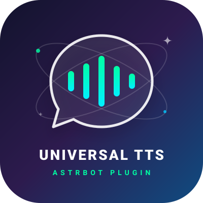

<div align="center">



# Universal TTS / 通用 TTS

**让每一条消息都能听见**

[](https://github.com/AstrBotDevs/AstrBot)
[](LICENSE)
[]()
[](https://github.com/CyrilPeng/astrbot_plugin_universal_tts/actions/workflows/ci.yml)

一个为 [AstrBot](https://github.com/AstrBotDevs/AstrBot) 打造的通用语音合成插件。
支持多种引擎，覆盖国内外主流 TTS 服务，还能自定义接入任意 HTTP API。

</div>

---

## ✨ 亮点

- 🎯 **即插即用** — 通过消息链钩子在发送前把文本替换为语音，零配置冲突
- 🌐 **跨平台** — 经源码核实支持 14 个平台适配器：aiocqhttp · QQ 官方机器人 · Telegram · Discord · KOOK · 飞书 · Satori · Slack · WebChat · 企业微信 · 企业微信智能机器人 · 微信客服 · 微信公众号 · 钉钉（aiocqhttp 为生产实测，其余依据适配器的 `Record` 发送实现判定）
- 🔄 **热切换** — 运行时可一条指令切换引擎，无需手动进入后台重启
- 🌍 **多引擎覆盖** — MiMo · OpenAI · 火山引擎 · 阿里云 · Azure · ElevenLabs
- 🛠️ **万能适配** — 自定义 HTTP 引擎，模板化接入任何 TTS API
- 🎨 **WebUI 完整管理页** — 插件详情页内置五标签视图（含指令与帮助）：引擎增删改查/排序/试听、音色样本上传下载重命名、会话绑定管理、全局设置与变更历史，另支持配置与会话绑定的导出导入，保存即生效
- 🧠 **智能跳过与引擎健康统计** — 代码块、纯链接、自定义正则命中的回复不朗读；每个引擎实时记录成功/失败/耗时与最近错误

---

## 📦 支持的引擎

| 提供商 | 引擎 | 特点 |
|--------|------|------|
| **MiMo** | V2-TTS | 预置音色 + `<style>` 标签风格控制 |
| **MiMo** | V2.5-TTS | 精品音色 + 自然语言风格控制 |
| **MiMo** | V2.5-VoiceDesign | 文本描述生成音色 |
| **MiMo** | V2.5-VoiceClone | 音频样本克隆任意音色 |
| **OpenAI** | 兼容 TTS | `/v1/audio/speech` 标准接口 |
| **火山引擎** | SAMI TTS | 字节跳动，丰富发音人 |
| **阿里云百炼** | CosyVoice | DashScope 兼容接口 |
| **Azure** | Cognitive Services | SSML + 情感风格 + 角色扮演 |
| **ElevenLabs** | Text-to-Speech | 多语言高保真语音 |
| **自定义** | HTTP TTS | 模板化接入任意 API |

---

## 🚀 安装

在 AstrBot 管理面板 → 插件市场，通过仓库地址安装：

```
https://github.com/CyrilPeng/astrbot_plugin_universal_tts
```

> 需要 AstrBot `>= 4.25.0`。插件依赖 `on_waiting_llm_request` 钩子（4.11.0+）与插件 Web API `register_web_api`（4.25.0+，用于 WebUI 管理页）。旧版本请使用 v1.3.4。

## ⚙️ 配置

1. 进入插件配置页
2. 点击「TTS 引擎配置列表」添加引擎（按 `[提供商]` 分组）
3. 填写 API Key 和参数
4. 确保需要接管的机器人已开启 AstrBot 的 TTS 功能；关闭 TTS 的机器人会保持文本输出

> 💡 引擎列表中第一个为默认引擎，也可通过「当前生效的引擎实例名称」指定。

---

## 🎮 指令

所有指令必须以 `/` 开头。

管理命令默认仅管理员可用。如果平台事件无法识别管理员身份，请在插件配置的 `admin_user_ids` 中填写允许使用管理命令的用户 ID。

| 指令 | 说明 |
|------|------|
| `/tts_test [文本]` | 测试当前会话引擎的合成效果 |
| `/tts_status` | 查看 TTS 总开关、全局默认和当前会话状态 |
| `/tts_engines` | 列出所有已配置引擎（标注全局/本会话状态） |
| `/tts_bind <序号>` | 为当前群聊/私聊绑定专属引擎 |
| `/tts_bind 0` | 关闭当前会话 TTS |
| `/tts_unbind` | 解除当前会话的绑定，回退全局 |
| `/tts_switch <序号>` | 切换全局默认引擎（管理员） |
| `/tts_switch 0` | 关闭全局默认 TTS（管理员） |
| `/tts_off` | 暂停全部会话的自动 TTS（管理员） |
| `/tts_on` | 恢复全部会话的自动 TTS（管理员） |
| `/tts_bindings` | 查看全局引擎及所有会话绑定（管理员） |
| `/tts_unbind_all` | 清除所有会话绑定（管理员） |
| `/tts_limit_on` | 开启 TTS 字数上限 |
| `/tts_limit_off` | 关闭 TTS 字数上限 |
| `/tts_limit_set <数字>` | 设置字数上限 |

---

## 🔀 会话级引擎绑定

不同群聊、私聊可以使用不同的 TTS 引擎，互不干扰。

- 在某个群里输入 `/tts_bind 2`，该群就会使用第 2 个引擎
- 输入 `/tts_bind 0` 可关闭当前群聊/私聊的 TTS
- 输入 `/tts_switch 0` 可关闭全局默认 TTS，但不影响已绑定具体引擎的会话
- 管理员可用 `/tts_off` 暂停所有会话的自动 TTS，之后用 `/tts_on` 恢复，原有绑定不会被修改
- 其他群和私聊不受影响，继续使用全局默认
- 输入 `/tts_unbind` 可解除绑定，回退全局
- 绑定关系持久化存储，重启不丢失

---

## 🔢 TTS 字数上限

可设置单次 TTS 转换的字数上限，防止长文本导致合成时间过长或费用过高。

- 超过上限的回复不触发 TTS，以原始文本形式发送
- 支持 UI 面板和指令两种方式配置
- 默认上限 50 字符，可自定义

**指令方式：**
- `/tts_limit_on` — 开启字数上限
- `/tts_limit_off` — 关闭字数上限
- `/tts_limit_set <数字>` — 设置字数上限

---

## 🛠️ 自定义 HTTP 引擎

不在预置列表里的 TTS 服务？用模板化配置搞定。

### 占位符

| 占位符 | 含义 |
|--------|------|
| `${TEXT}` | 待合成文本 |
| `${TEXT_JSON}` | JSON 字符串形式的待合成文本，自动处理引号和换行 |
| `${API_KEY}` | 你配置的密钥 |
| `${VOICE_SAMPLE_BASE64}` | 音色样本 base64（含 data URI） |
| `${VOICE_SAMPLE_BASE64_RAW}` | 音色样本纯 base64 |
| `${VOICE_SAMPLE_PATH}` | 音色样本文件路径 |

### 示例：接入返回二进制音频的 API

```
URL:      https://api.example.com/v1/tts
Method:   POST
Headers:  Authorization: Bearer ${API_KEY}
Body:     {"text": ${TEXT_JSON}, "voice": "alloy"}
响应类型:  binary
音频格式:  mp3
```

### 示例：接入返回 JSON + base64 的 API

```
URL:      https://api.example.com/v1/chat/completions
Method:   POST
Headers:  api-key: ${API_KEY}
Body:     {"model": "tts", "messages": [{"role": "assistant", "content": ${TEXT_JSON}}]}
响应类型:  json
音频路径:  choices.0.message.audio.data
音频编码:  base64
音频格式:  wav
```

---

## 🧩 开发者：扩展新引擎

```
engines/
├── your_provider/
│   ├── __init__.py      # 导出引擎类
│   └── engine.py        # 继承 TTSEngine，实现 synthesize()
└── __init__.py           # 在 ENGINE_REGISTRY 中注册
```

三步完成：
1. 新建 `engines/your_provider/`，实现 `synthesize(text) -> (bytes, format)`
2. 在 `engines/__init__.py` 中导入并注册
3. 在 `_conf_schema.json` 中添加配置模板

---

## 🧪 开发与测试

仓库自带 226 项后端用例与前端静态一致性检查，push / PR 时由 GitHub Actions 自动运行（Python 3.10 / 3.12 矩阵）：

```bash
pip install pyyaml
python tests/test_webui.py      # 后端：Web API、引擎管理、绑定、导入导出、指令规格一致性
python tests/test_frontend.py   # 前端：els 引用 / DOM id / i18n 键 / 标签成对 / 禁用模态 API
```

测试在最小 stub 环境下加载真实插件代码，不依赖 AstrBot 运行时；新增指令、Web 路由或平台声明时若未同步登记，对应用例会直接失败。

---

## 📄 许可证

本项目基于 [AGPL-3.0](LICENSE) 协议开源。

---

<div align="center">

**Made with ❤️ for AstrBot**

</div>
