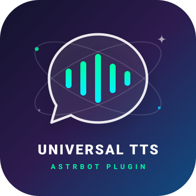

<div align="center">



# Universal TTS / 通用 TTS

**让每一条消息都能听见**

[](https://github.com/AstrBotDevs/AstrBot)
[](LICENSE)
[]()
[](https://github.com/CyrilPeng/astrbot_plugin_universal_tts/actions/workflows/ci.yml)

一个为 [AstrBot](https://github.com/AstrBotDevs/AstrBot) 打造的通用语音合成插件。
通过消息链钩子在发送前把文本替换为语音，多引擎热切换，内置完整 WebUI 管理页。

</div>

---

## 目录

- [亮点](#highlights)
- [支持的引擎](#engines)
- [安装](#install)
- [快速上手](#quickstart)
- [指令参考](#commands)
- [核心能力](#features)
- [WebUI 管理页](#webui)
- [与 AstrBot 核心 TTS 的关系](#core-tts)
- [自定义 HTTP 引擎](#custom-http)
- [参与开发](#dev)
- [常见问题](#faq)
- [许可证](#license)

<a id="highlights"></a>
## ✨ 亮点

- **即插即用** — 钩子拦截实现，不改动 AstrBot 核心流程
- **多引擎热切换** — 运行时可切换全局引擎，无需重启后台
- **会话级音色** — 不同群聊、私聊可用不同引擎，绑定持久化
- **说话懂分寸** — 代码块、纯链接、超长回复自动不朗读
- **完整 WebUI** — 引擎、样本、绑定、设置、帮助五个标签页可视化管理
- **跨平台** — 经源码核实支持 14 个平台适配器（见[平台支持](#platforms)）

<a id="engines"></a>
## 📦 支持的引擎

| 提供商 | 引擎 | 特点 |
|--------|------|------|
| **MiMo** | V2.5-TTS | 精品预置音色，支持唱歌模式与自然语言风格控制 |
| **MiMo** | V2.5-VoiceDesign | 文本描述生成音色 |
| **MiMo** | V2.5-VoiceClone | 音频样本克隆任意音色 |
| **OpenAI** | 兼容 TTS | 标准 `/v1/audio/speech` 接口 |
| **火山引擎** | SAMI TTS | 字节跳动，发音人丰富 |
| **阿里云百炼** | CosyVoice | DashScope 兼容接口 |
| **Azure** | Cognitive Services | SSML、情感风格、角色扮演 |
| **ElevenLabs** | Text-to-Speech | 多语言高保真语音 |
| **自定义** | HTTP TTS | 模板化接入任意 API（见[自定义 HTTP 引擎](#custom-http)） |

> MiMo 官方已于 2026-06-30 下线 `mimo-v2-tts` 并静默映射至 `mimo-v2.5-tts`，本插件已移除 V2 模板；存量实例会在启动时自动迁移。

<a id="platforms"></a>
### 平台支持

经源码核实、适配器确实会发送 `Record` 组件的平台：

| 类别 | 平台 |
|------|------|
| QQ 体系 | aiocqhttp（生产实测）、QQ 官方机器人 |
| 国际主流 | Telegram、Discord、Slack |
| 国内生态 | 飞书、企业微信、企业微信智能机器人、钉钉 |
| 微信体系 | 微信客服、微信公众号 |
| 通用协议 | Satori、WebChat、KOOK |

`mattermost`、`line`、`misskey` 的外发形式尚未确认，`qq_official_webhook` 无 `Record` 处理，均未列入。

<a id="install"></a>
## 🚀 安装

在 AstrBot 管理面板 → 插件市场，通过仓库地址安装：

```
https://github.com/CyrilPeng/astrbot_plugin_universal_tts
```

**前置条件**

1. **AstrBot `>= 4.25.0`** — WebUI 管理页依赖插件 Web API `register_web_api`；低于该版本会缺少管理页（引用还原另需 `on_waiting_llm_request`，4.11.0+）。
2. **开启 AstrBot 的全局 TTS** — 路径：配置 → 服务提供商 → TTS。插件依赖该开关判断是否接管，关闭时保持文本输出。
3. **机器人平台在支持列表内** — 见[平台支持](#platforms)。

<a id="quickstart"></a>
## ⚡ 快速上手

1. 进入插件配置页，在「TTS 引擎配置列表」中新建引擎，填好服务地址与密钥。
2. 在引擎列表点「设为默认」，让它接管全部会话。
3. 发送 `/tts_test`，或在群里正常对话，确认能收到语音。
4. 需要给某个群单独换音色时，到「会话绑定」页指定即可。

<a id="commands"></a>
## 🎮 指令参考

所有指令均需以 `/` 开头，不加斜杠不会响应。

**普通指令**

| 指令 | 说明 |
|------|------|
| `/tts_help` | 查看指令帮助与当前状态 |
| `/tts_status` | 查看总开关、全局默认和当前会话状态 |
| `/tts_engines` | 列出全部引擎及编号（标注全局/本会话） |
| `/tts_bind <序号>` | 为当前群聊/私聊绑定专属引擎 |
| `/tts_bind 0` | 关闭当前会话 TTS |
| `/tts_unbind` | 解除当前会话的绑定，回退全局 |
| `/tts_test [文本]` | 立即合成一条语音验证配置 |

**管理员指令**

| 指令 | 说明 |
|------|------|
| `/tts_switch <序号>` | 切换全局默认引擎 |
| `/tts_switch 0` | 关闭全局默认 TTS |
| `/tts_off` | 暂停全部会话的自动合成 |
| `/tts_on` | 恢复自动合成 |
| `/tts_bindings` | 查看全部会话绑定 |
| `/tts_unbind_all` | 清除全部会话绑定 |
| `/tts_limit_on` | 开启文本长度上限 |
| `/tts_limit_off` | 关闭文本长度上限 |
| `/tts_limit_set <数字>` | 设置文本长度上限 |

> 管理命令默认仅管理员可用。若平台事件无法识别管理员身份，请在插件配置的 `admin_user_ids` 中填写允许使用的用户 ID；也可关闭 `admin_only_commands` 放开限制。

<a id="features"></a>
## 🔧 核心能力

### 会话级绑定与筛选

不同群聊、私聊可以使用不同引擎，互不干扰：

- `/tts_bind 2` 让当前会话固定使用第 2 个引擎；`/tts_bind 0` 单独静音该会话
- 绑定关系持久化存储，重启不丢失
- 「会话绑定」页提供四个视图：**全部 / 已绑定 / 跟随全局 / 近期活跃**
- 近期活跃视图按最后发言时间排序，含已绑定会话并标注状态；一键即可把「跟随全局」的会话转正为显式绑定

### 文本长度上限与智能跳过

- **字数上限**：超过设定字数（默认 50）的回复不转语音，按原文发送，避免合成耗时与费用失控
- **智能跳过**：含 ``` 围栏代码块的回复默认不朗读；整条消息只有长链接时同样跳过
- **自定义正则**：在「全局设置」中逐条填写正则（如 `^\d{4,8}$` 跳过验证码），命中即不朗读；无效正则会被忽略并告警

### 发送失败回退文本

语音消息发送失败（例如协议端无法编码语音）时，自动改为发送原始文本，避免用户侧完全没有回复；可在设置中关闭。

### 引擎健康统计

每个引擎实时记录成功/失败次数、平均耗时与最近错误，直接显示在引擎卡片上。「试听」走草稿配置，不计入正式统计。

### 配置导入导出

支持把配置与会话绑定一并导出为 JSON，用于迁移；导入时逐字段校验类型，任一字段非法则整体拒绝，绑定的引擎名必须存在。

<a id="webui"></a>
## 🎨 WebUI 管理页

插件详情页内置五个标签，改动保存即生效：

| 标签 | 职责 |
|------|------|
| 引擎 | 增删改查、复制、排序、设为默认、在线试听、健康统计 |
| 音色样本 | 上传、下载、重命名；供 VoiceClone / VoiceDesign 类引擎使用 |
| 会话绑定 | 全部 / 已绑定 / 跟随全局 / 近期活跃四个视图 |
| 全局设置 | 开关、字数上限、跳过规则、权限白名单、临时文件策略；底部为变更历史与配置导入导出 |
| 指令与帮助 | 实时状态速览、指令卡片（示例可点击复制）、快速上手、权限说明、常见问题 |

> 视图运行在沙箱 iframe 中，部分浏览器 API 不可用；筛选选择等界面状态仅在当前页面有效。

<a id="core-tts"></a>
## ⚠️ 与 AstrBot 核心 TTS 的关系

AstrBot 核心自身也有一条 TTS 管道：当你在「配置 → 服务提供商 → TTS」中配置了核心 TTS 提供商且开启总开关时，它会在消息发送前再合成一遍，且**不受本插件的任何限制约束**（ historically 出现过 80 字上限下仍输出数分钟超长语音的情况）。

自 **v1.4.4** 起，本插件在这些场景下会把结果标记为普通消息，使核心管道不再接管，回复按原文发送：

- 命中字数上限
- 命中智能跳过规则
- 触发概率未命中
- `/tts_off` 暂停期间
- 会话被 `/tts_bind 0` 禁音

两种情况不做抑制：**插件总开关关闭**时交还给原生行为；**「内容安全 → 回复检查」开启**时不抑制，以免绕过安全检查。

如果你同时安装了核心 TTS 类插件（如 MiMo TTS），请注意两者的叠加关系。

<a id="custom-http"></a>
## 🛠️ 自定义 HTTP 引擎

不在预置列表里的 TTS 服务，可通过模板化配置接入。

### 占位符

| 占位符 | 含义 |
|--------|------|
| `${TEXT}` | 待合成文本 |
| `${TEXT_JSON}` | JSON 字符串形式的待合成文本，自动处理引号和换行 |
| `${API_KEY}` | 你配置的密钥 |
| `${VOICE_SAMPLE_BASE64}` | 音色样本 base64（含 data URI） |
| `${VOICE_SAMPLE_BASE64_RAW}` | 音色样本纯 base64 |
| `${VOICE_SAMPLE_PATH}` | 音色样本文件路径 |

### 示例一：返回二进制音频

```
URL:      https://api.example.com/v1/tts
Method:   POST
Headers:  Authorization: Bearer ${API_KEY}
Body:     {"text": ${TEXT_JSON}, "voice": "alloy"}
响应类型:  binary
音频格式:  mp3
```

### 示例二：返回 JSON + base64

```
URL:      https://api.example.com/v1/chat/completions
Method:   POST
Headers:  api-key: ${API_KEY}
Body:     {"model": "tts", "messages": [{"role": "assistant", "content": ${TEXT_JSON}}]}
响应类型:  json
音频路径:  choices.0.message.audio.data
音频编码:  base64
音频格式:  wav
```

<a id="dev"></a>
## 🧑‍💻 参与开发

扩展一个新引擎只需三步：

```
engines/
├── your_provider/
│   ├── __init__.py      # 导出引擎类
│   └── engine.py        # 继承 TTSEngine，实现 synthesize()
└── __init__.py           # 在 ENGINE_REGISTRY 中注册
```

1. 新建 `engines/your_provider/`，实现 `synthesize(text) -> (bytes, format)`
2. 在 `engines/__init__.py` 中导入并注册
3. 在 `_conf_schema.json` 中添加配置模板

**测试**

仓库自带 319 项后端用例与前端静态一致性检查，push / PR 时由 GitHub Actions 自动运行（Python 3.10 / 3.12 矩阵）：

```bash
pip install pyyaml httpx
python tests/test_webui.py      # 后端：Web API、引擎管理、绑定、导入导出、指令规格一致性
python tests/test_frontend.py   # 前端：els 引用 / DOM id / i18n 键 / 标签成对 / 沙箱 API 禁用
```

测试在最小 stub 环境下加载真实插件代码，不依赖 AstrBot 运行时；新增指令、Web 路由或平台声明时若未同步登记，对应用例会直接失败。

<a id="faq"></a>
## ❓ 常见问题

**收不到语音**
先确认三处开关均为开启：插件的「插件总开关」、AstrBot 的「全局 TTS」、以及「自动合成」（`/tts_off` 会暂停）。再确认当前会话没有被 `/tts_bind 0` 单独禁音——在该会话发送 `/tts_status` 可直接看到原因。

**文字太长没有语音**
字数上限开启时，超长回复会被跳过并以原文发送。用 `/tts_limit_set <数字>` 调整，或 `/tts_limit_off` 关闭。

**代码块或纯链接的回复没有语音**
这是内置的智能跳过规则，避免朗读无意义内容。含代码块的回复默认跳过；可在「全局设置 → 跳过包含代码块的回复」调整。

**明明设置了字数上限，却收到了很长的语音**
若同时配置了核心 TTS 提供商，请先看[与 AstrBot 核心 TTS 的关系](#core-tts)。v1.4.4 起插件会抑制这种情况；若仍复现，请确认插件版本不低于 1.4.4。

**只有某个群没声音**
可能被单独禁音（`/tts_bind 0`），在该群发 `/tts_status` 查看；也可到「会话绑定」页的「跟随全局」视图确认其实际引擎。

**改完配置没生效**
WebUI 的改动会立即生效；若刚在 AstrBot 的插件配置表单里改过，页面会提示刷新，刷新一次即可。

**音色克隆 / 音色设计能用唱歌模式吗**
不能。唱歌仅预置音色模型（`mimo-v2.5-tts`）支持。

<a id="license"></a>
## 📄 许可证

本项目基于 [AGPL-3.0](LICENSE) 协议开源。

---

<div align="center">

**Made with ❤️ for AstrBot**

</div>
